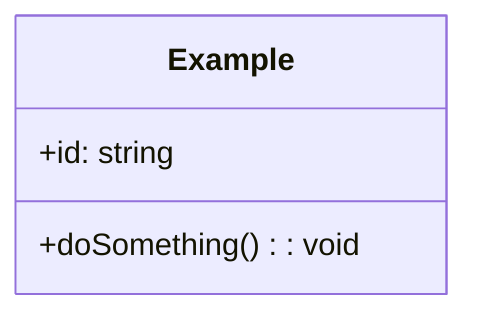
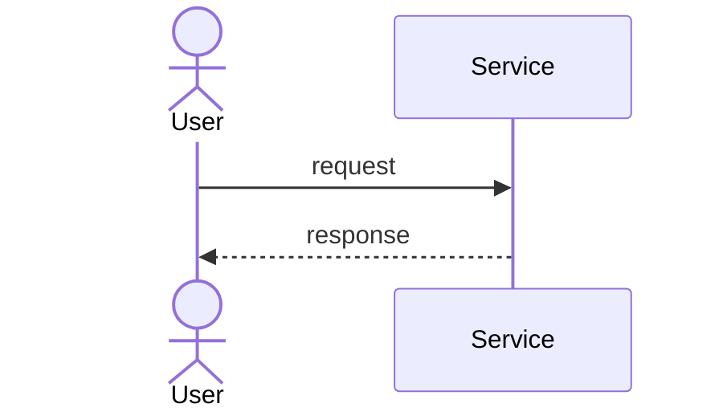

# Employee Directory & Org Chart — Design

Fill this in **before** writing code. Time-box: 15 minutes of the 35.

## 1. Clarifications I asked / assumptions I made

-

## 2. Core entities

| Entity | Responsibility (one sentence) | Key fields |
|---|---|---|
|  |  |  |

## 3. Class diagram

## 4. Key flows (sequence)

## 5. Patterns used and why

| Pattern | Where | The requirement that forced it |
|---|---|---|
|  |  |  |

## 6. SOLID check

- **S**:
- **O**: which follow-up can be added by adding a class only?
- **L**:
- **I**:
- **D**:

## 7. Concurrency & failure handling

- Shared mutable state:
- Locking / atomicity strategy:
- What happens on partial failure:

## 8. Trade-offs and what I'd do with more time

-

## 9. Follow-up impact

| Follow-up | Classes added | Classes modified |
|---|---|---|
| Dotted-line (matrix) reporting |  |  |
| Historical org chart as of a date |  |  |
